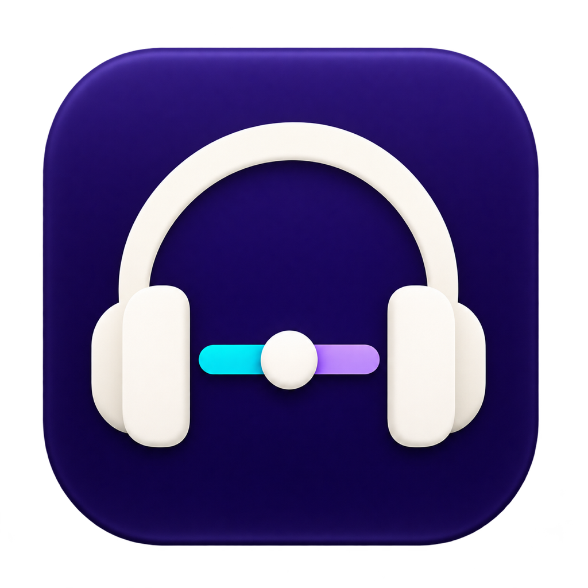
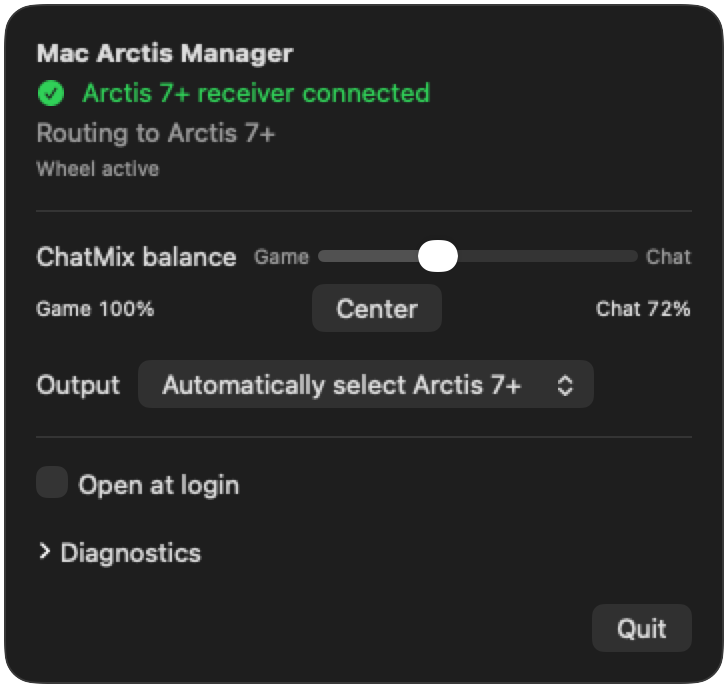

<p align="center">
  
</p>

<h1 align="center">Mac Arctis Manager</h1>

<p align="center">
  <strong>ChatMix for the SteelSeries Arctis 7+ on macOS.</strong><br>
  Balance game audio and Discord from your headset wheel or the menu bar, without SteelSeries GG or Sonar.
</p>

<p align="center">
  <a href="https://github.com/GewoonDani/Mac-Arctis-Manager/releases/latest"><strong>Download</strong></a>
  · <a href="#quick-start">Quick start</a>
  · <a href="#test-and-report">Test and report</a>
</p>

<p align="center">
  <br>
  <sub>Preview of the app’s menu with example routing and ChatMix values.</sub>
</p>

## Compatibility

- **Mac** — Apple Silicon, macOS 14 or later.
- **Headset** — SteelSeries Arctis 7+ with the USB receiver `1038:220e`. The physical ChatMix wheel has been verified on one Mac.
- **Testing status** — Offline tests cover both virtual audio streams and the mixer. Audio recovery after reconnect and installation of a notarized build on a clean Mac still need live testing.

## Quick start

1. Download the app ZIP and `ArctisAudio.pkg` from [GitHub Releases](https://github.com/GewoonDani/Mac-Arctis-Manager/releases/latest). Open the package, install the virtual audio driver with administrator credentials, and restart macOS when convenient.
2. Extract **Mac Arctis Manager.app**, move it to Applications, and open it. Click the headphones icon in the menu bar. The app automatically selects a single matching Arctis 7+ output. You can also choose it from the **Output** picker.
3. If prompted, choose **Allow Virtual Audio Input**. macOS calls this **Microphone** access because the driver provides two loopback monitor inputs. The app opens those two inputs only.
4. Set your audio outputs as follows. In **Audio MIDI Setup**, you can check whether both virtual outputs are available.

   | Audio source | Select |
   | --- | --- |
   | Game audio, music, or apps that follow the macOS sound output | **Arctis Game** |
   | Discord or another voice chat app | **Arctis Chat** as the app’s output |
   | Voice chat microphone | Your physical headset microphone as the app’s input |

5. Turn the headset’s ChatMix wheel and look for **Wheel active**, or adjust the slider in the menu. If you see **Open Input Monitoring Settings**, grant the app access there and relaunch it.

The app keeps routing while the menu is closed. **Arctis Game** and **Arctis Chat** appear while the app runs and disappear when you quit it. After a force quit, this takes about five seconds. macOS or an audio app may select another output when a virtual output disappears. Enable **Open at login** if you want the app to start automatically.

> The GitHub build is ad-hoc signed and has no Apple notarization. If macOS blocks the app or installer and you trust the download, try opening it first, then check **System Settings → Privacy & Security → Open Anyway**. You may need to confirm each file separately. [Apple Support](https://support.apple.com/en-us/102445)

## Test and report

Play game audio and join a Discord call at the same time. Check that you can hear both at the center position and that turning the wheel fully toward either side isolates that source. Unplug and reconnect the USB receiver and see whether audio resumes. If an app switched outputs, reselect its virtual output.

If something fails, share your macOS version, headset model, and the app’s **Diagnostics** output in a [GitHub issue](https://github.com/GewoonDani/Mac-Arctis-Manager/issues). If the wheel does not respond, you can also [capture a passive USB log](Docs/Hardware.md).

### Test with two tones

With the app reporting **Routing to Arctis 7+**, start at a low headset volume and run `dist/release/arctis-tone` from a local build. It plays 440 Hz to **Arctis Game** and 660 Hz to **Arctis Chat** for 20 seconds. In **Diagnostics**, both input peaks should rise and the rendered frame count should advance.

## Build from source

Use Xcode with Swift 6 and run these commands from the repository root.

```sh
Scripts/test.sh
Scripts/build.sh
```

The build places the ad-hoc signed app, driver, installer, and diagnostic tools in `dist/release/`. The build and tests run without installing the driver. For a read-only list of the current audio devices, run:

```sh
"dist/release/Mac Arctis Manager.app/Contents/MacOS/MacArctisManager" --list-audio
```

## Uninstall

1. Switch macOS and your apps back to a physical output. Turn off **Open at login** and quit Mac Arctis Manager.
2. From the repository root, run `Scripts/uninstall-driver.sh`, confirm removal, and restart macOS when convenient.
3. Move **Mac Arctis Manager.app** to Trash. Saved settings and any custom wheel calibration remain in your user account for reuse.

The app and driver use public APIs with SIP enabled.

[Architecture](Docs/Architecture.md) · [Distribution](Docs/Distribution.md) · [MIT License](LICENSE) · [Third-party attribution](THIRD_PARTY.md)
